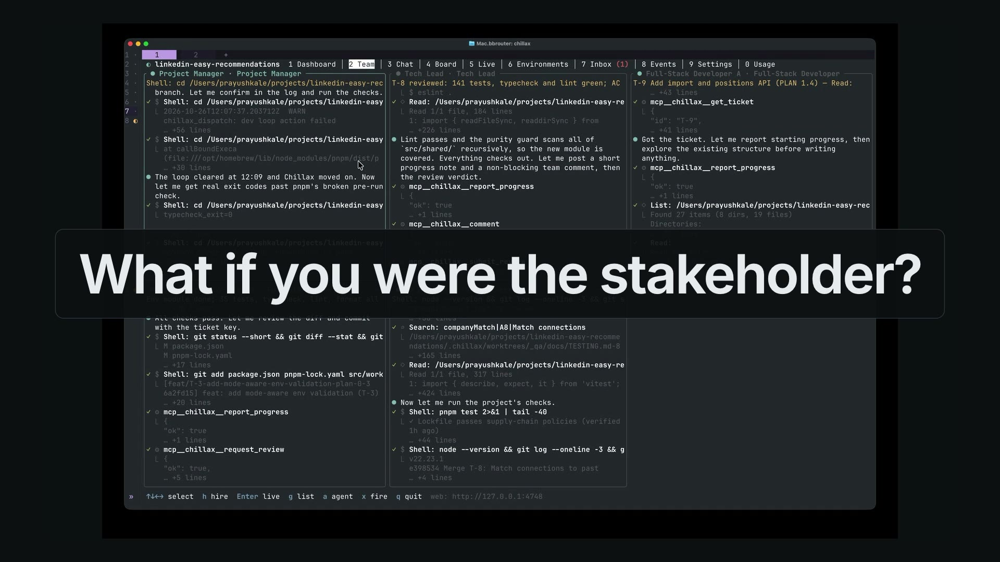

# Chillax

> *chill* + *relax*. **You are the stakeholder. Chillax runs the company.**

[](media/chillax-ad-45s.mp4)

▶ **[Watch the 45-second ad](media/chillax-ad-45s.mp4)** · **[Watch the full 5-minute walkthrough](https://github.com/prayushkale/chillax-app/releases/latest)**

Chillax is a terminal-first manager for an AI product team. You don't babysit a coding
agent. You hire a team of them: a project manager, developers, a tech lead and QA. They plan, build,
review, test and release, the way a real software company does. You make the calls that
matter: approve the sprint, answer questions, approve the release.

> **Source coming soon.** Chillax is in active development and the code is private while
> a few rough edges get fixed. This repository is the public home until then. **Star or
> watch it** to hear when the source opens up.

---

## Why

Coding agents are good at writing code. Running one on its own still leaves you to do the job
of a whole company: planning, splitting the work, reviewing, testing, deciding what ships.
Chillax gives those jobs to agents with clear roles and puts **gates** where a human
should decide.

## How it works

```
 You (stakeholder)
   │  chat
   ▼
 Project Manager ──► epics, stories, acceptance criteria, a proposed sprint
   │
   ▼
 ┌───────────────┐
 │ Sprint gate   │  nothing starts until you approve
 └───────────────┘
   │
   ▼
 Developers ──► one git worktree + branch per ticket ──► tests run
   │
   ▼
 Tech Lead review ──► merge to `dev`
   │
   ▼
 QA ──► promote `dev` → `qa`, test against acceptance criteria, file bugs or sign off
   │
   ▼
 ┌───────────────┐
 │ Release gate  │  nothing ships without you
 └───────────────┘
   │
   ▼
 `qa` → `main`, tagged, with release notes
```

| A real company | In Chillax |
|---|---|
| Stakeholder | You |
| Job description | A role file: a system prompt plus a policy |
| Employee | A hired coding agent (Claude Code, Codex, Command Code, …) |
| Jira | A built-in local tracker: epics, stories, bugs, sprints |
| Dev / QA / Prod | Git branches, worktrees and your project's own commands |
| Company handbook | Chillax's MCP tools, which agents use to follow the process |

### The pieces

- **Hire anyone.** Each employee is an existing coding agent, driven over the
  [Agent Client Protocol](https://agentclientprotocol.com). Choose the agent and model
  per hire. Chillax doesn't rebuild a coding agent. It manages them.
- **Plan with your PM.** Describe what you want. The PM writes epics and stories with
  acceptance criteria and proposes a sprint.
- **The dev loop.** Each ticket gets its own worktree and branch. A developer builds it,
  Chillax runs your tests, and a Tech Lead reviews the diff. Approved work merges into `dev`
  in a separate worktree, so your own checkout is never touched.
- **QA and the bug loop.** QA tests each ticket against its acceptance criteria. Bugs go
  back to developers as tickets.
- **An inbox for you.** Permission requests, questions, the sprint approval and the release
  approval all wait for you in one place.
- **Watch it live.** The same views in the terminal and in the browser: dashboard, team,
  chat, board, a live feed of every agent's tool calls, environments, inbox, and token
  usage per ticket.
- **Pause, quit, resume.** Every change is an event in a local log. Quit at any time.
  When you come back, the team, chats, tickets and inbox are rebuilt where you left them.

### The honest trade-off

Chillax plans heavily, so it uses more tokens and time than handing one prompt to one
agent. In return you get structure. Every piece of work has a ticket, the reasoning is in
its comments, and nothing reaches `main` without you.

## Status

Chillax is an **MVP**. Planning, hiring, the sprint gate, the autonomous dev loop, QA
rounds, the bug loop and the release gate all work in code and are covered by end-to-end
tests. Real-agent runs have taken a project from the PM's plan to a tagged release, as the
walkthrough shows. Some steps still need a stakeholder's nudge.

Next on the list: more tracker adapters (Jira, GitHub), more verified agent backends,
themes and plugins, and hardening work such as budgets and crash recovery.

## Demos

- **[45-second ad](media/chillax-ad-45s.mp4)**
- **[Full walkthrough (5 min)](https://github.com/prayushkale/chillax-app/releases/latest)**:
  setup, planning with the PM, hiring, the sprint gate, the dev loop, the live view,
  QA, the release gate and the finished project. Captions are included as an `.srt` file.

## Follow along

Star ⭐ or watch 👀 this repository to hear when the source is published.
